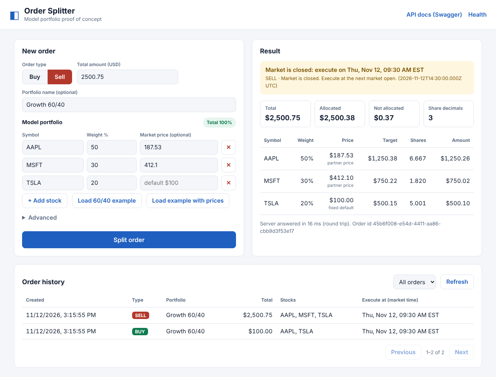

# Order Splitter

A small API for a robo-advisor partner. You send a model portfolio and an amount. It sends back how much to buy or sell of each stock, how many shares that is, and when to execute. It also keeps the order history.

Built with NestJS and TypeScript. Data is kept in memory only, so it is gone after a restart.



## Run it

You need Node.js 20 or newer.

```bash
npm install
npm run start:dev      # or: npm run build && npm run start:prod
```

Then open:

| What | URL |
| --- | --- |
| Console (simple UI to try the API) | http://localhost:3000/ |
| Swagger (docs and interactive testing) | http://localhost:3000/docs |
| API | http://localhost:3000/api/v1/orders |
| Health check | http://localhost:3000/health |

No setup is needed. To change settings, copy `.env.example` to `.env`.

## Endpoints

| Method | Path | What it does |
| --- | --- | --- |
| `POST` | `/api/v1/orders` | Splits the amount, says when to execute, saves the order |
| `GET` | `/api/v1/orders` | Order history, newest first. Query: `orderType`, `limit` (1-100, default 20), `offset` |
| `GET` | `/api/v1/orders/{id}` | One order from the history |
| `GET` | `/health` | Liveness check |

### Request body for `POST /api/v1/orders`

Content type is `application/json`.

| Field | Type | Required | Rules |
| --- | --- | --- | --- |
| `orderType` | string | yes | `BUY` or `SELL` |
| `totalAmount` | number | yes | USD, 0.01 to 10,000,000, up to 2 decimals |
| `portfolioName` | string | no | Label for the history, max 100 characters |
| `portfolio` | array | yes | 1 to 100 stocks, each symbol only once |
| `portfolio[].symbol` | string | yes | 1-10 characters. Lower case is accepted and stored in upper case |
| `portfolio[].weight` | number | yes | Percent, 0.01 to 100, up to 2 decimals. All weights must add up to exactly 100 |
| `portfolio[].price` | number | no | Market price from the partner, 0.01 to 1,000,000, up to 4 decimals. If missing or `null`, the fixed price ($100) is used |

Numbers must be JSON numbers (`100`, not `"100"`). Unknown fields are rejected, including `__proto__`, `constructor` and `prototype`. The body can be up to 100 KB and at most 10 levels deep.

Optional header: `Idempotency-Key` (1 to 128 characters, no spaces). Send the same key when you retry and you get the first order back instead of a duplicate. The response then has the header `Idempotent-Replayed: true`.

Keys are kept separately from the order history (up to `MAX_IDEMPOTENCY_KEYS`, default 100,000). If the order itself has already been dropped from history because of `MAX_STORED_ORDERS`, a retry with its key gets `409` instead of creating the order again. Only after a restart, or once 100,000 newer keys have been used, is a key forgotten and treated as new.

## Request examples

### 1. The example from the brief: $100 into AAPL 60% and TSLA 40%

```bash
curl -X POST http://localhost:3000/api/v1/orders \
  -H "Content-Type: application/json" \
  -d '{
    "orderType": "BUY",
    "totalAmount": 100,
    "portfolio": [
      { "symbol": "AAPL", "weight": 60 },
      { "symbol": "TSLA", "weight": 40 }
    ]
  }'
```

Response (`201 Created`):

```json
{
  "id": "b0a41d1e-a8d7-486e-aa79-5231ec3c7efd",
  "orderType": "BUY",
  "totalAmount": 100,
  "currency": "USD",
  "quantityDecimals": 3,
  "orders": [
    { "symbol": "AAPL", "weight": 60, "price": 100, "priceSource": "DEFAULT", "targetAmount": 60, "quantity": 0.6, "amount": 60 },
    { "symbol": "TSLA", "weight": 40, "price": 100, "priceSource": "DEFAULT", "targetAmount": 40, "quantity": 0.4, "amount": 40 }
  ],
  "allocatedAmount": 100,
  "unallocatedAmount": 0,
  "execution": {
    "executeAt": "2026-11-12T14:30:00.000Z",
    "executeAtMarketTime": "2026-11-12T09:30:00.000-05:00",
    "marketOpenNow": false,
    "timezone": "America/New_York",
    "note": "Market is closed. Execute at the next market open."
  },
  "createdAt": "2026-11-12T09:12:00.254Z"
}
```

### 2. SELL, with market prices from the partner and a safe retry key

```bash
curl -X POST http://localhost:3000/api/v1/orders \
  -H "Content-Type: application/json" \
  -H "Idempotency-Key: 6f1c2f0e-partner-retry-1" \
  -d '{
    "orderType": "SELL",
    "totalAmount": 2500.75,
    "portfolioName": "Growth",
    "portfolio": [
      { "symbol": "AAPL", "weight": 50, "price": 187.53 },
      { "symbol": "MSFT", "weight": 30, "price": 412.10 },
      { "symbol": "TSLA", "weight": 20 }
    ]
  }'
```

AAPL and MSFT use the partner price. TSLA has no price, so it uses the fixed $100.

### 3. History

```bash
curl "http://localhost:3000/api/v1/orders"
curl "http://localhost:3000/api/v1/orders?orderType=SELL&limit=10&offset=0"
curl "http://localhost:3000/api/v1/orders/<order-id>"
```

### 4. An invalid request

```bash
curl -X POST http://localhost:3000/api/v1/orders \
  -H "Content-Type: application/json" \
  -d '{ "orderType": "HOLD", "totalAmount": -1, "portfolio": [{ "symbol": "AAPL", "weight": 50 }] }'
```

Every error has the same shape:

```json
{
  "statusCode": 400,
  "error": "Bad Request",
  "message": "Validation failed",
  "details": [
    "orderType must be one of the following values: BUY, SELL",
    "totalAmount must not be less than 0.01",
    "portfolio weights must add up to exactly 100"
  ],
  "path": "/api/v1/orders",
  "requestId": "57576d6b-4fa5-4fa7-8710-760396ff775c",
  "timestamp": "2026-11-12T09:12:26.940Z"
}
```

| Status | When |
| --- | --- |
| 400 | Body, query or id is not valid |
| 404 | No order with that id |
| 409 | Same `Idempotency-Key` sent again with a different body, or its order has already been dropped from history |
| 413 | Body larger than 100 KB |
| 422 | The amount is too small to trade any share, or a quantity has too many digits to be returned exactly |

## How the numbers are worked out

1. **Amount per stock** = weight x total amount, in whole cents. Spare cents go to the stocks with the largest remainder, so the parts always add up to the total.
2. **Price** = the partner's price if sent, otherwise the fixed price.
3. **Quantity** = amount / price, rounded **down** to the allowed decimals. Rounding down means we never trade more than the partner asked for.
4. **`amount`** = quantity x price, rounded **down** to the cent, so it never shows more than is really traded (99.99 x $3.3333 = $333.2967 shows as $333.29). **`allocatedAmount`** is the sum of the amounts and **`unallocatedAmount`** is the rest, so the two always add up to the total.
5. **When to execute**: now if the market is open (Monday to Friday, 09:30 to 16:00 New York time, except configured holidays), otherwise the next market open.

All maths uses `decimal.js`, not floating point.

## Edge cases handled

| Case | What happens |
| --- | --- |
| Weights do not add up to 100, or a symbol appears twice | 400 with a clear message |
| Numbers sent as text, missing fields, unknown fields | 400. One message per field, the most basic problem first |
| `__proto__`, `constructor` or `prototype` keys, anywhere in the body or query | 400, like any other unknown field |
| Numbers written like `1e-7`, lists inside lists, `null` items, a list as the body | 400, never a 500 |
| A body nested thousands of levels deep | 400 (limit is 10 levels), never a 500 |
| Odd cents, for example $0.05 across three stocks | Split as 2, 1 and 2 cents, so the parts add up to the total |
| Quantity does not divide evenly | Rounded down. The leftover is returned as `unallocatedAmount` |
| quantity x price has more than 2 decimals | `amount` is rounded down to the cent, never up |
| One stock rounds to 0 shares | Returned with quantity 0, so the partner can skip it |
| Every stock rounds to 0 shares | 422, nothing is stored |
| A quantity with more than 15 digits (possible with 8 decimals and huge amounts) | 422, because a JSON number could not hold it exactly |
| Same request sent twice with the same `Idempotency-Key` | The first order is returned, no duplicate. Five at the same time still create one |
| Same key with a different body | 409 |
| Request rejected, then retried with the same key | The key is not used up |
| Order placed on a weekend, after the close or on a holiday | `executeAt` is the next market open |
| Daylight saving change | Handled. The open stays at 09:30 market time |
| Body larger than 100 KB | 413 |
| Order id in upper case | Found |
| Client closes the connection early | Logged as `ABORTED` with the time |
| More than `MAX_STORED_ORDERS` orders | The oldest are dropped. Their `Idempotency-Key`s are kept, so a late retry gets 409, not a duplicate |
| A wrong setting, such as `QUANTITY_DECIMALS=99` | The app refuses to start and says why |

## Settings

All are environment variables and all are optional. Wrong values stop the app at start with a clear message.

| Variable | Default | Meaning |
| --- | --- | --- |
| `QUANTITY_DECIMALS` | `3` | Decimal places for share quantities (0 to 8). Change to `7` and restart, no code change |
| `DEFAULT_STOCK_PRICE` | `100` | Fixed price used when the partner sends none |
| `MARKET_TIMEZONE` | `America/New_York` | Time zone of the market |
| `MARKET_OPEN` / `MARKET_CLOSE` | `09:30` / `16:00` | Market hours |
| `MARKET_HOLIDAYS` | none | Extra closed days, for example `2026-11-26,2026-12-25` |
| `MAX_STORED_ORDERS` | `10000` | Orders kept in memory. Oldest are dropped first |
| `MAX_IDEMPOTENCY_KEYS` | `100000` | Idempotency-Keys kept in memory, separately from orders. Must be at least `MAX_STORED_ORDERS` |
| `PORT` | `3000` | HTTP port |

## Response time in the console

Every request prints one line with the time in milliseconds:

```
[Nest] LOG  [HTTP] POST /api/v1/orders 201 2.41 ms [adc87e03-bdf8-4094-8f7d-053271846b61]
[Nest] LOG  [HTTP] GET /api/v1/orders?limit=1 200 1.04 ms [2bcebaf5-90d3-4add-bf2e-b0eab55085fb]
[Nest] WARN [HTTP] POST /api/v1/orders 400 2.60 ms [2f687752-6f88-4a41-b4f3-548c6b8f1cee]
```

The value in brackets is the request id. It is also returned in the `X-Request-Id` header and in error bodies.

## Tests

```bash
npm test             # unit + end-to-end
npm run test:cov     # with coverage report
npm run lint:check
```

185 tests. Coverage: 100% lines and functions, 99% statements, 92% branches. The test run fails if coverage drops below 95% (90% for branches).

| Test file | What it covers |
| --- | --- |
| `order-splitter.spec.ts` | The maths: the brief's example, partner price, decimals 0 to 8, rounding down, odd cents, 100 stocks, 300 random portfolios |
| `market-calendar.service.spec.ts` | Open and closed times, weekends, daylight saving, holidays, another time zone |
| `create-order.dto.spec.ts` | Every input rule: about 60 valid and invalid requests |
| `orders.service.spec.ts` | Create, history, idempotency, too-small and too-precise orders |
| `orders.repository.spec.ts` | Storing, paging, filter, memory caps for orders and keys |
| `orders.controller.spec.ts` | Headers and idempotency key format |
| `app.config.spec.ts` | Settings: defaults, limits, bad values |
| `common.spec.ts` | Request log line, error format, unsafe-input check, health |
| `test/app.e2e-spec.ts` | The real HTTP API from outside, including bad input, limits, other settings and holidays |

## Project layout

```
src/
  main.ts                     starts the app
  app.setup.ts                pipes, filters, Swagger, static files
  config/                     settings from environment variables, checked at start
  orders/
    order-splitter.ts         the maths (pure function, no framework)
    orders.service.ts         use cases: create, list, get, idempotency
    orders.repository.ts      in-memory store
    orders.controller.ts      REST endpoints
    dto/                      request shapes and validation
  market/                     when the market is open
  common/                     request logging, error format, unsafe-input check
  health/                     health check
public/                       the console page (plain HTML, CSS, JS)
test/                         end-to-end tests
```

## Libraries used

| Library | Why |
| --- | --- |
| `@nestjs/*` (core, common, platform-express) | Framework |
| `@nestjs/swagger` | Swagger docs at `/docs` |
| `@nestjs/config` | Loads `.env` |
| `class-validator`, `class-transformer` | Request validation |
| `decimal.js` | Exact money and share maths |
| `luxon` | Time zones and daylight saving |
| `helmet` | Security headers |
| `jest`, `supertest` | Tests |
| `eslint`, `prettier` | Code quality |

## Docker

```bash
docker build -t order-splitter .
docker run -p 3000:3000 order-splitter
```

I wrote the Dockerfile but could not run Docker on the machine I used, so please treat it as untested.

## More

See [ANSWERS.md](ANSWERS.md) for my approach, assumptions, challenges, production changes and how I used LLMs.
